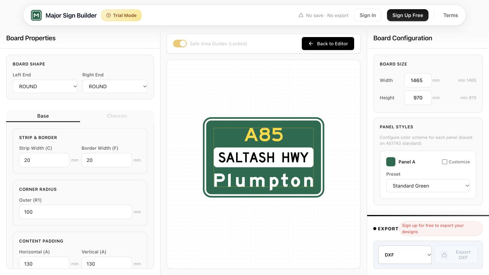
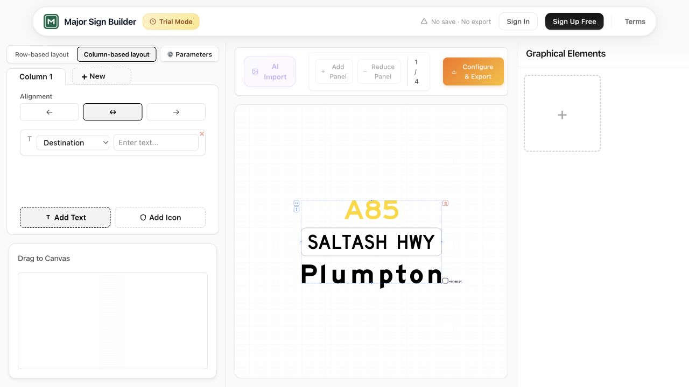

# Major Sign Builder

**A road-sign design prototype connecting text, arrow geometry and board layout with CAD export.**

**[Watch the 1:03 product demo on YouTube →](https://www.youtube.com/watch?v=1EWgh93NGWQ)**

Follow a sample sign through layout revisions, arrow editing and DXF export, ending with the result opened in CAD.

*The editor combines a sign preview with physical dimensions, border settings and panel styling. Click the image to watch the demo.*

## Why I built it

While working as a road engineer, I found sign design conceptually straightforward: arranging geometry, text and spacing. The AutoCAD plug-ins I used made revisions cumbersome. A local change could affect other parts of the layout and create substantial rework.

I explored whether a dedicated browser editor could make that workflow more direct: edit the content and geometry, inspect the board, then carry the design into CAD.

## From layout to CAD

1. **Build the sign content.** Combine route numbers, road names, destinations and graphical elements.
2. **Revise the design.** Adjust text, arrow geometry, element placement and panels in the browser.
3. **Configure the board.** Review dimensions, borders, corner geometry and panel styling.
4. **Continue in CAD.** Export the layout as DXF for further work outside the editor.

*Sign content remains selectable on the canvas, with the text group and its layout controls visible together.*

## Design choice: preserve the CAD handoff

A browser preview is only part of the engineering workflow. The design also needs to remain useful after export.

The prototype uses millimetres for geometry and selected AS 1742/1743-related layout rules. Its DXF implementation includes line and arc entities for arrow geometry, together with text and layer handling, so the handoff retains drawing structure rather than only a rendered image.

## Feedback from industry

I demonstrated the prototype to a friend working in the industry. Two concrete requests were:

- Point-to-point snapping between elements, followed by numerical distance entry for precise placement.
- Separate CAD layers for different elements, to support downstream organisation and editing.

These requests highlighted two practical requirements: precise placement inside the editor and control over the drawing structure after export.

## My role and project stage

I identified the workflow problem through my road-engineering experience, set the product direction and requirements, and reviewed iterations. Implementation was primarily completed with AI assistance. The project grew from an arrow-building prototype into a broader sign-layout workspace.

I also explored commercialisation and approached industry practitioners. Those contacts did not develop into an ongoing commercial project, and I did not carry the commercial effort forward. This case presents the engineering product prototype and its early industry feedback.

**Project stack:** React, TypeScript, geometry and DXF export modules; the wider application includes Supabase authentication and storage code and subscription integrations.
